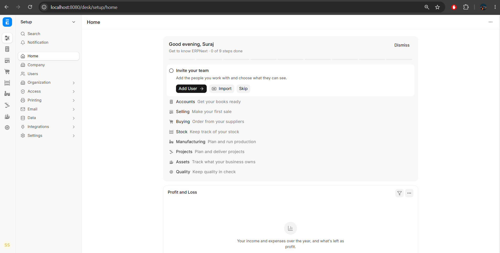
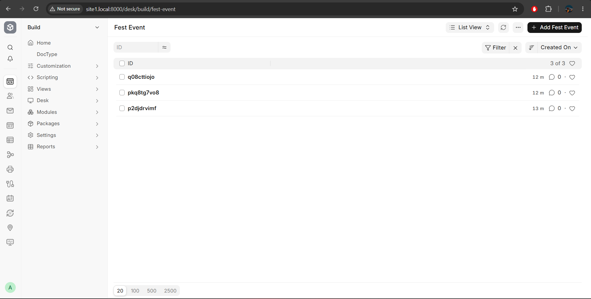

# Frappe & ERPNext Warm-Up Exercise

## Overview

This repository contains my submission for the Frappe & ERPNext Warm-Up Exercise. The objective was to set up Frappe Framework and ERPNext locally, create a custom DocType, and add sample records.

## Operating System and Environment

- Windows 11
- Ubuntu 24.04 LTS using WSL
- Frappe Framework v16.53.0
- ERPNext v16.52.1
- Python 3.14
- Node.js 24
- MariaDB 11.8
- Redis 7
- Frappe Bench CLI

## What I Created

I created a custom DocType named **Fest Event** with the following fields:

| Field Name | Field Type | Description |
|---|---|---|
| Event Name | Data | Name of the event |
| Date | Date | Date of the event |
| Venue | Data | Location of the event |
| Capacity | Int | Maximum event capacity |

I also added three sample event records and verified them in the Fest Event list view.

## Steps I Followed

1. Set up Ubuntu 24.04 LTS using Windows Subsystem for Linux (WSL).
2. Installed the required development dependencies, including Python, Node.js, Yarn, MariaDB, and Redis.
3. Installed the Frappe Bench CLI.
4. Initialized a new Frappe v16 bench.
5. Downloaded the ERPNext v16 application.
6. Created a local site named `site1.local`.
7. Installed ERPNext on the site and completed the initial setup wizard.
8. Created a custom DocType named `Fest Event` with four fields.
9. Added three sample event records.
10. Verified the records in the Fest Event list view.

## Challenges Faced

The main challenges were configuring the local development environment, resolving a Redis Queue connection issue during ERPNext installation, and configuring hostname resolution for `site1.local` on Windows.

I resolved these issues by starting the Bench development processes and updating the Windows hosts file. This helped me understand the basic setup, configuration, and troubleshooting process in Frappe and ERPNext.

## Screenshots

### ERPNext Workspace

### Fest Event List View

## Learnings

- Learned the basics of the Frappe Framework and ERPNext.
- Understood how to initialize a Frappe Bench and create a local site.
- Learned how to create a custom DocType and define field types.
- Practiced adding records and viewing them in a list view.
- Gained hands-on experience with WSL, MariaDB, Redis, and local development environment troubleshooting.

## Conclusion

This exercise provided hands-on experience with setting up Frappe Framework and ERPNext locally, creating a custom DocType, and managing sample records. It also improved my understanding of the Frappe development workflow and basic troubleshooting.
